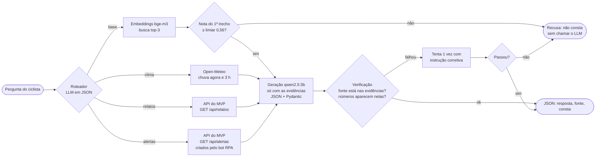

# CicloAlerta · Inteligência: assistente com LLM local, RAG e agente

> Global Solution 2026.2 · CitizenTech · Engenharia de Software 4º ano · disciplina **Generative AI for Engineering**
> Atividade: *Treinamento de uma LLM local* · Tema do professor: **mobilidade e segurança**

Este README é o relatório técnico da disciplina. Ordem: 01 integrantes · 02 Ficha Técnica e o que a IA resolve ·
03 pipeline · 04 base de conhecimento · 05 performance · 06 cinco erros · 07 conclusão e links.
No fim: como reproduzir.

## 01 · Integrantes

| Nome completo | RM |
| --- | --- |
| Breno Silva | RM97864 |
| Enrico Marquez | RM99325 |
| Gustavo Dias | RM550820 |
| Joel Barros | RM550378 |
| Leonardo Moreira | RM550988 |

## 02 · Ficha Técnica do MVP e o que a IA resolve

| Campo | Conteúdo |
| --- | --- |
| Nome do produto | CicloAlerta |
| Cidadão e território | Ciclistas e entregadores de bicicleta elétrica nas ciclovias da cidade de São Paulo (área piloto: Av. Paulista e Av. Brigadeiro Faria Lima) |
| Problema, em uma frase | Buracos e desníveis nas ciclovias causam quedas, e na chuva ficam escondidos pela água |
| Proposta de valor | Saber antes de sair, e durante o trajeto, onde estão os trechos perigosos, com alerta mais forte em dia de chuva |
| Arquitetura: componentes | Site + API (FastAPI), detector de buracos (YOLO), **assistente (LLM local com RAG e agente, este repositório)**, pipeline de dados (Airflow + Databricks), bot de triagem e alertas (Python), robô com sensor (ESP32), publicado com Docker, Terraform e CI/CD |
| Fontes de dados | Open-Meteo (chuva), malha cicloviária do GeoSampa, relatos feitos no próprio MVP (parte simulada e documentada), legislação de trânsito (CTB e Resolução Contran 996/2023) |
| Modelos de IA utilizados | YOLO treinado para buracos; LLM local `qwen2.5:3b` via Ollama; embeddings `bge-m3` |
| Repositório | https://github.com/Leonardo-Valerio/cicloalerta-ia |
| Indicadores de impacto | Perigos mapeados, % de relatos confirmados, alertas enviados em dias de chuva, tempo até o perigo ser resolvido |
| ODS conectados | ODS 11 (meta 11.2, transporte seguro e acessível), ODS 3 (meta 3.6, reduzir mortes e lesões no trânsito), ODS 9 (meta 9.1, infraestrutura resiliente) |

### A tarefa da IA

O ciclista e o entregador têm dúvidas práticas que hoje se resolvem com boato de grupo de WhatsApp:
*"posso pedalar na calçada?", "bicicleta elétrica precisa de placa?", "como peço para tapar esse buraco?",
"vai chover na Faria Lima?"*. Um LLM genérico responde com confiança, e erra.

**O assistente do CicloAlerta responde em português simples, em até 3 frases, sempre citando a fonte
(artigo de lei, página da Prefeitura ou dado ao vivo), e diz "não consta" quando não sabe.**
A saída é sempre um JSON `{"resposta", "fonte", "consta"}`, consumido pela tela Assistente do site.

Como contribui para os ODS: informação correta sobre direitos e deveres do ciclista (ODS 3.6 e 11.2) e um caminho
direto para pedir o conserto da via no SP156 (ODS 9.1).

### Por que "agente" e não ajuste de pesos (LoRA)

A rubrica aceita **LoRA ou agente** como especialização. Escolhemos o agente porque:
o conhecimento muda (chuva de agora, relatos de hoje, alertas ativos) e pesos treinados não acompanham isso;
leis mudam e uma base editável se atualiza sem retreinar; e a citação obrigatória da fonte é verificável numa base
de trechos, não em pesos. Com 32 trechos, um LoRA também teria poucos exemplos para aprender.
O modelo base (`qwen2.5:3b`) é o mesmo nas três configurações, o que torna a comparação justa.

## 03 · Pipeline de IA



O diagrama mostra o agente v1. Na **v2** (a usada pela API), o roteador tem saída restrita por JSON Schema, e os
caminhos `clima`, `relatos` e `alertas` não passam pelo LLM: a resposta é montada por template com os números da
ferramenta. Só o caminho `base` usa geração e verificação.

| Configuração | O que faz | Código |
| --- | --- | --- |
| **1. Sem contexto** | o mesmo LLM, só com a pergunta, pedindo o mesmo JSON | `src/pipelines.py::sem_contexto` |
| **2. RAG simples** | busca top-3, recusa abaixo do limiar, gera citando o id do trecho | `src/pipelines.py::rag` |
| **3. Agente** | roteador escolhe a ferramenta (base, clima, relatos, alertas), gera e verifica fonte e números; se falhar, corrige ou recusa | `src/pipelines.py::agente`, `src/ferramentas.py` |
| **4. Agente v2** | o mesmo agente com as correções dos erros 2 e 4: roteador restrito por JSON Schema (`enum`) e resposta por template para clima, relatos e alertas | `src/pipelines.py::agente_v2` |

**Busca (item 03).** Cada trecho é indexado como `fonte + texto` com `bge-m3` (multilíngue, roda local).
Com 32 trechos, a busca exata por cosseno em numpy é instantânea e transparente, então não precisamos de índice aproximado (FAISS/Chroma).

| Métrica (25 perguntas com resposta na base) | Valor |
| --- | --- |
| recall@1 | **88,0%** |
| recall@3 | **100,0%** |

**Limiar justificado.** Comparamos a nota do melhor trecho nas perguntas com resposta (mínimo 0,570, mediana 0,670)
e sem resposta (mediana 0,528, máximo 0,672). O corte que maximiza a acurácia balanceada é **0,56**:
100% das perguntas com resposta passam e 82% das sem resposta são recusadas antes de chamar o LLM
(acurácia balanceada 90,9%). Os 18% que passam (ex.: *"em quantos dias a prefeitura é obrigada a tapar o buraco?"*,
que é parecida com os trechos do SP156) ficam a cargo do prompt e da verificação.
Detalhes e histograma: [`notebooks/01_busca_e_limiar.ipynb`](notebooks/01_busca_e_limiar.ipynb).

**Geração fundamentada (item 04).** Exemplos de JSON válido, citação e recusa em
[`notebooks/02_geracao_fundamentada.ipynb`](notebooks/02_geracao_fundamentada.ipynb). Três saídas reais:

```json
{"resposta": "A potência máxima do motor de uma bicicleta elétrica é de até 1000 W (mil watts).", "fonte": "r996-art2-iii", "consta": true}
{"resposta": "Não consta na base de conhecimento do CicloAlerta.", "fonte": "", "consta": false}
{"resposta": "Sim, está chovendo agora na Avenida Paulista com 0.3 mm de precipitação.", "fonte": "open-meteo:paulista", "consta": true}
```

E o mesmo modelo **sem contexto**, para a pergunta *"Qual o valor em reais da multa para quem estaciona o carro na ciclofaixa?"*:

```json
{"resposta": "A multa para quem estaciona carro na ciclofaixa em São Paulo é de R$ 350,00.", "fonte": "CicloAlerta", "consta": true}
```

Valor inventado e fonte inventada. Com RAG, a mesma pergunta é recusada.

## 04 · Base de conhecimento

32 trechos em [`base/trechos.jsonl`](base/trechos.jsonl) (um dispositivo legal ou um assunto por trecho, com `id`, `fonte`, `url` e `texto`).
Os trechos legais são cópia do texto oficial, sem paráfrase.

| Fonte | Formato de origem | Licença / uso | Nº de trechos |
| --- | --- | --- | --- |
| Código de Trânsito Brasileiro, Lei nº 9.503/1997 (Planalto, texto compilado) | HTML | Ato oficial, não protegido por direito autoral (Lei 9.610/1998, art. 8º, IV) | 14 |
| Resolução Contran nº 996/2023 (bicicleta elétrica, autopropelidos, ciclomotores) | HTML | Ato oficial (Lei 9.610/1998, art. 8º, IV) | 9 |
| Prefeitura de São Paulo, Subprefeituras Ipiranga e Sapopemba: Tapa-Buraco / SP156 | HTML | Informação pública de órgão municipal, citada com fonte | 3 |
| FAQ CicloAlerta (regras do produto, escrito pela equipe) | Markdown | CC BY 4.0 | 6 |
| **Total** | | | **32** |

Detalhes em [`base/fontes.md`](base/fontes.md). As regras de alerta do FAQ são as mesmas do bot de RPA, para que
o assistente e o bot nunca se contradigam.

**Conjunto de teste (item 01):** 36 perguntas em [`avaliacao/perguntas.jsonl`](avaliacao/perguntas.jsonl):
25 com resposta na base (gabarito + trecho esperado + palavras-chave), **7 cuja resposta certa é "não consta"**
(seguro, marca, valor de multa em reais, capacete, Bike Sampa, estatística de mortes, prazo legal do tapa-buraco)
e 4 dinâmicas que dependem de dado ao vivo (chuva, relatos, alertas).

## 05 · Performance do modelo nas configurações testadas

Rodado em 18/11/2026 numa GTX 1650 (4 GB), `qwen2.5:3b`, temperatura 0. Resultados linha a linha em `avaliacao/resultados_*.jsonl`;
placar em [`avaliacao/placar.csv`](avaliacao/placar.csv) e [`notebooks/03_placar.ipynb`](notebooks/03_placar.ipynb).

As três configurações pedidas (sem contexto, RAG, agente) foram rodadas primeiro. Depois, analisamos os erros
(seção 06), aplicamos duas das correções propostas e rodamos uma quarta configuração, **agente v2**, sem alterar
os resultados das três primeiras.

| Configuração | Acerto total | Alucinação | Acerto (base, 25) | Recusa correta (não consta, 7) | Acerto (dinâmicas, 4) | Citação correta | JSON válido | Latência média |
| --- | --- | --- | --- | --- | --- | --- | --- | --- |
| Sem contexto | 13,9% | 61,1% | 8,0% | 42,9% | 0% | 0% | 100% | 1,2 s |
| RAG simples | 86,1% | **5,6%** | **96,0%** | **100%** | 0% | **92,0%** | 100% | 2,4 s |
| Agente (v1) | 83,3% | 11,1% | 80,0% | **100%** | 75,0% | 87,5% | 100% | 2,9 s |
| **Agente v2** (correções dos erros 2 e 4) | **91,7%** | 8,3% | 88,0% | **100%** | **100%** | 84,0% | 100% | **2,2 s** |

**Como cada pergunta foi classificada.** *Acerto*: a resposta contém o fato do gabarito (palavras-chave),
ou recusou uma pergunta "não consta", ou respondeu uma dinâmica citando a ferramenta. *Alucinação*: `consta=true`
com fato errado, fonte inventada ou sem apoio. *Recusa indevida*: recusou algo que a base responde.

### Interpretação

1. **O contexto é o que derruba a alucinação: de 61,1% para 5,6%.** Sem contexto, o modelo acertou só 2 das 25
   perguntas da base, respondeu com `consta=true` em 24 das 36 perguntas e nunca citou uma fonte verificável:
   escreveu "Conhecimento geral", "Estudos de mercado" e até uma **"Lei Municipal 1.646/2018"**, que ele inventou.
   Com RAG, acertou 24 de 25 e citou o trecho correto em 92%.
2. **A recusa "não consta" funcionou em todas as configurações com contexto (7/7).** 6 delas foram barradas pelo
   limiar, sem custo de LLM; a 7ª (prazo do tapa-buraco) passou do limiar e foi recusada pelo próprio modelo.
3. **Só o agente responde perguntas sobre o agora (RAG: 0 de 4).** Para o produto, é o que mais importa:
   "vai chover no meu trecho?" é a pergunta mais útil para o ciclista.
4. **O agente v1 perdeu 4 perguntas da base que o RAG acertou (96% → 80%).** Causas (seção 06): roteamento errado
   (q24); respostas diferentes para a mesma evidência, por não determinismo na GPU (q03, q04); e, na q14, a verificação
   barrou um número sem apoio ("15"), mas a segunda tentativa ainda errou. A verificação ajudou na citação: o RAG citou
   um id inexistente (`faq-alertas-1`) na q22, e o agente normalizou para o id válido (`faq-alertas`).
5. **O agente v2 é a melhor configuração no total (91,7%) e acerta as 4 dinâmicas.** Duas mudanças:
   - **roteador com saída restrita por JSON Schema e `enum`** no Ollama: o modelo só pode escolher uma das 4
     ferramentas e um dos locais válidos (corrige o erro 2);
   - **resposta por template para clima, relatos e alertas**: são dados numéricos, então a frase é montada direto dos
     dados da API, sem LLM (corrige o erro 4). Também deixa essas respostas mais rápidas e estáveis.

   Corrigiu q24 e q35 (os erros 2 e 4) e, de quebra, q04 e q14. Continua errando q03 e q10 (erros 3 e 1, que não
   tratamos), e **errou a q22, que a v1 acertava** (ver abaixo).
6. **Achado sobre a v1: vazamento do teste nos exemplos do roteador.** Ao revisar a v1, vimos que 4 exemplos do prompt
   do roteador eram quase iguais a perguntas de teste ("como o CicloAlerta decide um alerta crítico?" ≈ q22,
   "bicicleta elétrica precisa de placa?" ≈ q12, "vai chover na Paulista?" ≈ q33/q36, "tem buraco reportado na Faria
   Lima?" ≈ q34). Na v2, todos os exemplos foram reescritos com frases que não estão no conjunto de teste. Por isso a
   v2 é a comparação mais justa, e a perda da q22 mostra o custo real de não ter o exemplo "colado": o roteador ainda
   confunde "como o alerta funciona" (regra) com "existe alerta agora" (dado ao vivo).
7. **Conclusão do placar:** para perguntas sobre regras, o RAG simples ainda tem a melhor precisão e citação; para o
   produto completo, o **agente v2** é o melhor equilíbrio, com o maior acerto total, todas as perguntas dinâmicas e
   menor latência. É a configuração usada pela API `/perguntar`.

**Limitações da medição.** A correção é por palavras-chave (transparente e reproduzível, mas pode aceitar uma frase
com a palavra certa e o sentido errado: a v2 acertou a q04 citando o `ctb-art58` em vez do `ctb-art255`, o que aparece
na métrica de citação). Em `sem_contexto`, a q29 (capacete) foi contada como recusa porque o modelo marcou
`consta=false`, embora tenha escrito uma resposta. As perguntas dinâmicas dependem do dado do momento (a v1 rodou com
chuva prevista de 3,7 mm; a v2, com 0,0 mm). 36 perguntas é pouco para diferenças pequenas: 1 pergunta equivale a
2,8 pontos percentuais.

## 06 · Cinco erros reais, causa e correção

| # | Configuração | Pergunta | Resposta errada | Causa | Correção | Situação na v2 |
| --- | --- | --- | --- | --- | --- | --- |
| 1 | RAG e agente | q10 · *Até que velocidade o motor auxiliar de uma bicicleta elétrica pode ajudar?* | "até 6 km/h" (certo: 32 km/h) | **Busca:** o 1º trecho foi o § 4º (modo de assistência a pé, 6 km/h), nota 0,709, logo acima do art. 2º III (32 km/h), nota 0,701. O modelo usou o 1º. A verificação passou porque "6" está na evidência. | Reordenar o top-3 com um reranker (`bge-reranker-v2-m3`); dividir o trecho `r996-art2-p1-p4` para separar o modo a pé; instruir o modelo a preferir a definição principal quando dois trechos tiverem números diferentes para a mesma grandeza. | Proposta, não aplicada. **Ainda erra.** |
| 2 | Agente v1 | q24 · *Quais ciclovias o CicloAlerta cobre hoje?* | "O CicloAlerta não forneceu informações sobre ciclovias hoje." (recusa indevida) | **Roteador:** a palavra "hoje" levou à ferramenta `alertas` em vez da base. O modelo também copiou o molde do prompt como local (`"paulista\|faria lima\|null"`). | Saída estruturada com JSON Schema e `enum` no Ollama (o modelo não consegue inventar valores) e regra explícita: regra fixa é "base" mesmo com "hoje". | **Aplicada. Corrigido:** *"O CicloAlerta cobre atualmente as ciclovias da Avenida Paulista e da Avenida Brigadeiro Faria Lima"* (`faq-cobertura`). Efeito colateral: a q22 passou a ir para `alertas`. |
| 3 | Agente (v1 e v2) | q03 · *Posso andar de bicicleta na calçada?* | "Não... proibido pela Resolução Contran 996, art. 19." (certo: só se autorizado e sinalizado, CTB art. 59) | **Evidências conflitantes + não determinismo:** o top-3 trouxe o art. 59 do CTB e o art. 19 da Res. 996 (sobre bicicleta *elétrica* em calçadas). Com a mesma evidência, o RAG respondeu certo e o agente errado: a ordem das chamadas na GPU mudou a saída mesmo com temperatura 0 e semente fixa. | Marcar nos metadados a que veículo o trecho se aplica (`aplica_a: bicicleta_eletrica`) e filtrar pela pergunta; mandar o modelo citar o trecho mais específico; gerar 2 vezes e só aceitar se as duas concordarem (autoconsistência). | Proposta, não aplicada. **Ainda erra.** |
| 4 | Agente v1 | q35 · *Tem algum alerta crítico ativo nas ciclovias agora?* | "Não há alertas críticos ativos" com `consta=false`, quando a evidência dizia "7 alertas críticos" | **Leitura errada pelo modelo pequeno:** a evidência estava certa, e o modelo de 3B negou o conteúdo. A verificação só checa fonte e números quando `consta=true`; uma recusa que contradiz a evidência passa. O placar conta como "recusa segura", o que esconde o erro. | Para ferramentas com resposta numérica (clima, alertas, relatos), montar a resposta por template a partir dos dados, sem o LLM. | **Aplicada. Corrigido:** *"Há 7 alertas críticos e 9 alertas de atenção ativos agora. Os críticos estão em: Av. Brigadeiro Faria Lima, Av. Paulista."* |
| 5 | Agente v1 | q34 · *Quantos perigos estão reportados agora na ciclovia da Faria Lima?* | Exceção `TypeError` nas 3 tentativas; a pergunta ficou sem resposta | **Bug na ferramenta:** o MVP devolveu um relato com `lat: null` (dado inválido que o bot de RPA põe em quarentena), e a comparação de coordenadas quebrou. | `ferramentas._dentro` ignora relatos sem coordenada numérica. | **Corrigido (v1 reexecutada e v2):** *"Na ciclovia da Av. Brigadeiro Faria Lima há 15 perigos reportados (6 poças, 6 buracos, 2 obstáculos, 1 desnível)"*. |

**Erro novo, revelado pela v2 (q22 · *Quando o CicloAlerta emite um alerta crítico?*):** o roteador da v2 mandou a
pergunta para `alertas` e respondeu com a contagem de alertas ativos em vez da regra. Causa: sem o exemplo quase
idêntico que a v1 tinha no prompt, o modelo de 3B não separa "como o alerta funciona" de "existe alerta agora".
Correção proposta: se a pergunta começa com "quando", "como" ou "o que é", forçar a base; ou rotear com um
classificador por similaridade (embeddings de exemplos rotulados) em vez do LLM.

## 07 · Conclusão técnica e links

O mesmo `qwen2.5:3b`, sem ajuste de pesos, passou de **13,9% para 86,1% de acerto** e de **61,1% para 5,6% de
alucinação** quando passou a responder só com evidências e a recusar abaixo de um limiar medido. O agente acrescenta
o que o RAG não consegue: respostas sobre chuva, relatos e alertas do momento. A primeira versão do agente perdeu
precisão em perguntas estáticas; a análise dos erros levou à **v2**, que aplicou duas correções (roteador restrito por
JSON Schema e respostas por template para dados numéricos) e chegou a **91,7% de acerto total e 100% das perguntas
dinâmicas**. Os erros que restam (busca entre trechos vizinhos, evidências conflitantes e o roteador confundindo regra
com dado ao vivo) estão mapeados, com correção proposta.

**IA responsável no CicloAlerta**

- **Explicável:** toda resposta traz a fonte, e o agente devolve os passos (`roteador → ferramenta → verificação`) pela API.
- **Recusa em vez de inventar:** abaixo do limiar, sem evidência ou com verificação falhando, a resposta é "não consta".
- **Pessoa no circuito:** o assistente só informa. Não abre pedido no SP156 nem decide nada pelo cidadão.
- **LGPD:** LLM e embeddings rodam localmente (nenhuma pergunta sai da máquina para APIs de terceiros); a API não grava
  a pergunta nem a associa a IP ou usuário; a base não contém dados pessoais.
- **Resiliência:** se o LLM cair, `/perguntar` devolve o trecho mais relevante para a pessoa ler (degradação elegante);
  se o Open-Meteo ou a API do MVP caírem, o agente recusa em vez de inventar.

**Links**

- Repositório: https://github.com/Leonardo-Valerio/cicloalerta-ia
- Vídeo de demonstração: *preencher*
- Repositório do bot de RPA, que cria os alertas consultados pelo agente: https://github.com/Leonardo-Valerio/cicloalerta-rpa

---

## Como reproduzir

Requisitos: Python 3.11+, [Ollama](https://ollama.com) e cerca de 4 GB livres de RAM ou VRAM.

```bash
ollama pull qwen2.5:3b
ollama pull bge-m3

python -m venv .venv
.venv\Scripts\activate                  # Linux/macOS: source .venv/bin/activate
pip install -r requirements.txt
python -m ipykernel install --sys-prefix --name python3
```

Para as perguntas dinâmicas de relatos e alertas, suba a API do MVP (ou o MVP local do repositório de RPA,
`uvicorn mock_mvp.app:app --port 8000`) e, se for outra URL, defina `MVP_URL`.

```bash
# 1. Busca, recall e limiar (gera avaliacao/limiar.json)
python -m nbconvert --to notebook --execute --inplace notebooks/01_busca_e_limiar.ipynb

# 2. Placar das três configurações (~10 min em GPU; retoma de onde parou se cair)
python -m src.avaliar                     # sem_contexto, rag, agente e agente_v2

# 3. Exemplos e placar com gráficos
python -m nbconvert --to notebook --execute --inplace notebooks/02_geracao_fundamentada.ipynb
python -m nbconvert --to notebook --execute --inplace notebooks/03_placar.ipynb

# 4. API do assistente, consumida pelo site
uvicorn api.main:app --port 8001
curl -X POST http://127.0.0.1:8001/perguntar -H "Content-Type: application/json" \
     -d "{\"pergunta\": \"Bicicleta elétrica precisa de placa?\", \"modo\": \"agente\"}"
```

Variáveis (opcionais): `OLLAMA_URL`, `MODELO_LLM`, `MODELO_EMB`, `MVP_URL`. Nenhuma chave ou segredo é necessário.

**Em computador com 8 GB de RAM:** inicie o Ollama com `OLLAMA_MAX_LOADED_MODELS=1` e feche navegadores pesados.
Os vetores das perguntas são calculados uma vez e guardados em cache, para que embeddings e LLM não precisem ficar
juntos na memória.

## Estrutura

```
notebooks/   01 busca e limiar · 02 geração fundamentada · 03 placar (com saídas salvas)
base/        trechos.jsonl (32 trechos com fonte) e fontes.md
avaliacao/   perguntas.jsonl (36, com gabarito), resultados_*.jsonl, placar.csv, limiar.json
src/         busca, geração, agente, ferramentas e avaliação
api/         FastAPI: POST /perguntar e GET /health
```
